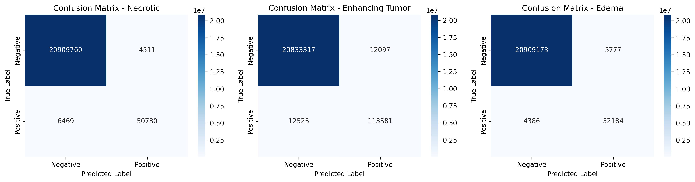
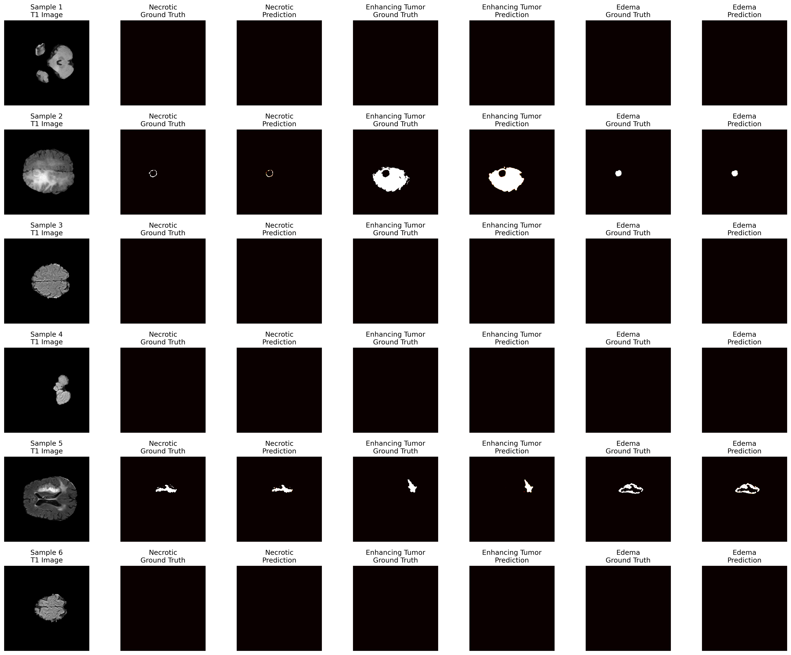

# BraTS 2020 Multi-Class Brain Tumor MRI Segmentation

Multi-class 2D segmentation of brain tumor subregions (Necrotic Core, Enhancing Tumor, and Peritumoral Edema) from 4-channel multimodal MRI (**T1, T1c, T2, FLAIR**) using a **U-Net with an EfficientNetB0 backbone**.

[](./LICENSE)
[](https://www.python.org/)
[](https://www.tensorflow.org/)
[](https://huggingface.co/spaces/emiraran/brats2020-brain-tumor-segmentation)

> **Codebase Audit & Refactor Note:**  
> The repository now separates the **refactored, patient-level leak-free pipeline** (`src/`) from the **archived v1 training notebook** (`model.ipynb`). All reported metrics below are from the original v1 run recorded in `model.ipynb`; the refactored `src/` modules fix the slice-level data split, full-set evaluation, and reporting bugs identified during audit (see [Known Limitations & Pipeline Refactor](#known-limitations--pipeline-refactor)).

---

## Architecture & Training Setup

* **Backbone & Decoder:** U-Net with `EfficientNetB0` encoder via `segmentation-models`
* **Encoder Initialization:** `encoder_weights=None` (trained from scratch to accept 4 MRI channels directly instead of 3-channel RGB ImageNet weights)
* **Input Shape:** `256 x 256 x 4` (`T1`, `T1c`, `T2`, `FLAIR` resized bilinearly from `240 x 240 x 4`)
* **Output Shape:** `256 x 256 x 3` (`sigmoid` probabilities for `Necrotic`, `Enhancing Tumor`, `Edema`)
* **Total Parameters:** `10,116,079` (`model.count_params()`)
* **Loss Function:** `DiceLoss + BinaryFocalLoss`
* **Optimizer & Schedule:** `Adam (lr=1e-4)`, `batch_size=16`, up to `50` epochs with `ModelCheckpoint` (`val_iou_score`), `EarlyStopping` (`patience=5`), and `ReduceLROnPlateau` (`factor=0.2, patience=3, min_lr=1e-6`)

---

## Dataset

Trained on the [BraTS 2020 Training Data (Kaggle)](https://www.kaggle.com/datasets/awsaf49/brats2020-training-data):

* **Patients / Volumes:** `369` 3D MRI scans (`155` axial slices per volume)
* **Total 2D `.h5` Slices:** `57,195` slices (`240 x 240 x 4` MRI + `240 x 240 x 3` mask)
* **Archived v1 Split (`model.ipynb`):** `45,756` training slices (`80%`) / `11,439` validation slices (`20%`)
* **Refactored Split (`src/data.py`):** `GroupShuffleSplit` grouped by `volume_<patient_id>` so all slices from a patient stay strictly in either train or validation

---

## Recorded Results (Archived v1 Run — `model.ipynb`)

> **Important Context:** These numbers come directly from the saved execution logs of `model.ipynb` (trained with an 80/20 **slice-level** split). Pixel-level specificity (~99.96%) is omitted from headline tables because ~99% of MRI pixels are background (`TN ~ 20.9M` vs. `TP ~ 50k–114k`).

### Full Validation Set (`11,439` slices, Epoch 49/50)
* **Best Validation IoU (`val_iou_score`):** `0.8045`
* **Best Validation Dice / F1 (`val_f1_score`):** `0.8864`
* **Validation Loss (`val_loss`):** `0.1164`

### Per-Class Breakdown (`320`-Slice Diagnostic Subset: `num_batches=20`, Threshold `0.5`)

| Tumor Subregion | Mean Dice +/- SD | Mean IoU +/- SD | Sensitivity (Recall) | Precision |
|---|---:|---:|---:|---:|
| **Necrotic Core** | `0.8613 +/- 0.0787` | `0.7644 +/- 0.1169` | `88.70%` | `91.84%` |
| **Enhancing Tumor** | `0.8891 +/- 0.0500` | `0.8039 +/- 0.0769` | `90.07%` | `90.37%` |
| **Peritumoral Edema** | `0.9086 +/- 0.0232` | `0.8333 +/- 0.0390` | `92.25%` | `90.03%` |
| **Macro Average (Subset)** | **`0.8863`** | **`0.8005`** | **`90.34%`** | **`90.75%`** |

---

## Visual Diagnostics

### Slice-by-Slice Volumetric Overlay


### Per-Class Pixel Confusion Matrices (320-Slice Subset)
Note: True Negative counts (`~20.9M`) reflect the large background region outside the tumor in axial brain MRI slices; sensitivity, precision, Dice, and IoU provide the meaningful signal for segmentation quality.


### Ground Truth vs. Model Predictions (6 Validation Examples)
Comparison across T1 input and all three target masks (Necrotic, Enhancing Tumor, Edema), including negative (tumor-free) axial slices (`Samples 1, 3, 4, 6`) and tumor-bearing slices (`Samples 2, 5`).


---

## Known Limitations & Pipeline Refactor

During technical review of the initial notebook (`model.ipynb`), three methodological issues were identified and resolved in the modular `src/` package:

1. **Slice-Level Data Leakage in `model.ipynb`:** Cell 2 used `sklearn.model_selection.train_test_split` over individual `.h5` slice paths, allowing adjacent axial slices from the same patient volume to appear in both training and validation sets. **`src/data.py` (`split_by_patient`) enforces patient-level `GroupShuffleSplit` by `volume_<id>`** with explicit disjoint-patient assertions. Because the ~65 GB dataset is not currently staged locally to re-run 50-epoch training, v1 notebook outputs are preserved transparently rather than altered without re-execution.
2. **Validation Subsampling in Diagnostic Cells:** Notebook Cells 5 and 8 computed confusion matrices and per-class Dice/IoU on `num_batches=20` (`320` of `11,439` validation slices). **`src/evaluate.py` defaults to `max_batches=None`**, evaluating the complete validation set.
3. **Reporting Bugs Fixed:** `model.ipynb` Cell 8 used a non-formatted string template (`{len(train_files)}`) and a hardcoded placeholder parameter count (`4,048,386` vs. the actual `10,116,079` reported by `model.count_params()`). **`src/metrics.py` (`format_evaluation_report`) generates exact, dynamically formatted summaries.**

---

## Repository Structure

```text
BraTS2020-Brain-Tumor-Segmentation/
├── src/
│   ├── __init__.py
│   ├── data.py               # Patient-ID parser, GroupShuffleSplit, Keras Sequence loader
│   ├── model.py              # U-Net (EfficientNetB0, encoder_weights=None) & callbacks
│   ├── metrics.py            # Per-class Dice, IoU, Sensitivity, Precision & report formatter
│   ├── evaluate.py           # Full-validation evaluation & diagnostic plots
│   └── train.py              # CLI training + evaluation entrypoint
├── tests/
│   └── test_pipeline.py      # Unit tests for zero-leakage splitting, HDF5 loading, and metrics
├── model.ipynb               # Archived v1 training & evaluation notebook (original run logs)
├── confusion_matrices.png    # Archived v1 per-class pixel confusion matrices
├── predictions_heatmap.png   # Archived v1 qualitative predictions vs. ground truth
├── tumor_animation.gif       # Axial slice-by-slice segmentation visualization
├── datasetlink.txt           # Kaggle dataset link and structure notes
├── requirements.txt
└── LICENSE
```

*(Trained checkpoints `best_model_weights.h5`, raw Kaggle `.h5` volumes, and generated reports are excluded via `.gitignore`. A deployed inference demo is hosted on [HuggingFace Spaces](https://huggingface.co/spaces/emiraran/brats2020-brain-tumor-segmentation).)*

---

## Setup & Usage

### 1. Clone and Install Dependencies
```bash
git clone https://github.com/EmirMuhammetARAN/BraTS2020-Brain-Tumor-Segmentation.git
cd BraTS2020-Brain-Tumor-Segmentation

python -m venv venv
# Windows: venv\Scripts\activate
# Linux/macOS: source venv/bin/activate
pip install -r requirements.txt
```

### 2. Run Unit Tests (No Dataset Download Required)
```bash
python -m unittest discover -s tests -v
```

### 3. Train & Evaluate with Patient-Level Splits
Download and extract the [BraTS 2020 `.h5` dataset](https://www.kaggle.com/datasets/awsaf49/brats2020-training-data) into `BraTS2020_training_data/content/data`, then run:
```bash
python -m src.train --data-dir BraTS2020_training_data/content/data --epochs 50 --batch-size 16
```

To evaluate an existing checkpoint over the entire validation set:
```bash
python -m src.evaluate --data-dir BraTS2020_training_data/content/data --weights best_model_weights.h5
```

---

## References

* Ronneberger, O., Fischer, P., & Brox, T. (2015). *U-Net: Convolutional Networks for Biomedical Image Segmentation*. MICCAI.
* Bakas, S., et al. (2018). *Identifying the Best Machine Learning Algorithms for Brain Tumor Segmentation, Progression Assessment, and Overall Survival Prediction in the BRATS Challenge*.
* Yakubovskiy, P. *Segmentation Models (`qubvel/segmentation_models`)*.
* Interactive Inference Demo: [huggingface.co/spaces/emiraran/brats2020-brain-tumor-segmentation](https://huggingface.co/spaces/emiraran/brats2020-brain-tumor-segmentation)

---

**Disclaimer:** This repository is a research and engineering project. It is not a certified medical device and is not intended for standalone clinical diagnosis.
